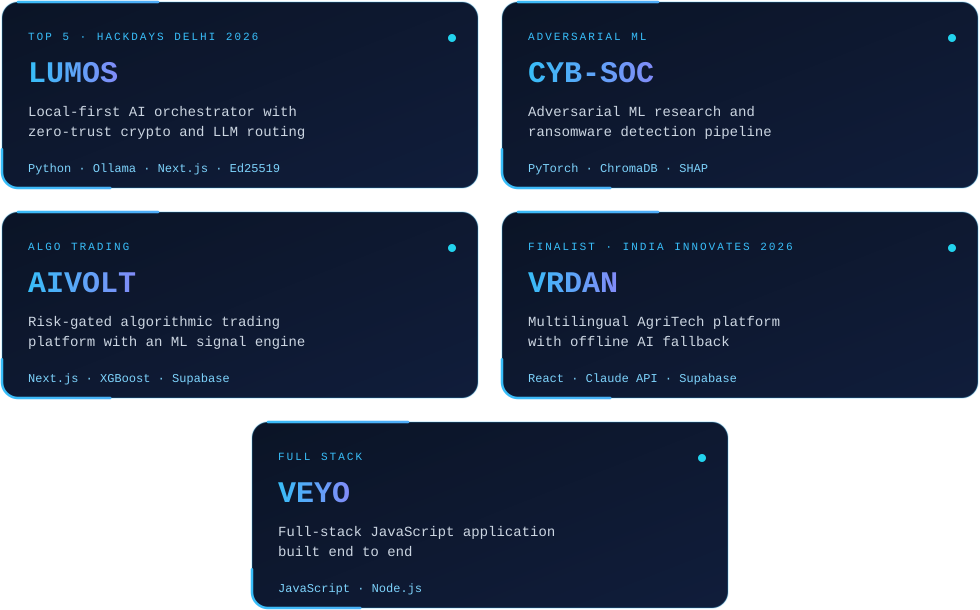

<div align="center">


[](https://github.com/Tamanna030507)

[](https://www.linkedin.com/in/tamanna-bal-29502239a/) [](mailto:tamannabal2007@gmail.com) [](https://github.com/Tamanna030507)

</div>

## `>>> print(model.summary())`

```python
class Tamanna(nn.Module):
    def __init__(self):
        super().__init__()
        self.role       = "AI/ML Engineer"
        self.education  = "B.Tech CSE @ Manipal University Jaipur"
        self.stack      = ["PyTorch", "LLMs", "FastAPI", "Next.js", "ChromaDB", "Docker", "Ed25519"]
        self.focus      = "Multi-Agent Orchestration & Adversarial ML"
        self.mission    = "Build safe, decentralized AI that works for real people"

    def forward(self, idea):
        return ship(break_it_fix_it(idea))
```

## The Lab

<div align="center">



[LUMOS](https://github.com/Tamanna030507/lumos-core) · [CYB-SOC](https://github.com/Tamanna030507/cyb-soc-intelligence) · [AIVOLT](https://github.com/Tamanna030507/aivolt-ml-trading) · [VRDAN](https://github.com/Tamanna030507/vrdan) · [VEYO](https://github.com/Tamanna030507/VEYO)

</div>

## Achievements

| Benchmark | Result |
|-----------|--------|
| **HackDays Delhi 2026** | **Top 5 of 1,000+** |
| **India Innovates 2026** | **National Finalist** (10M+ applicants) |
| **Policy Conclave '26, IIT Kanpur** | **Top 50 of 2,000+ teams** |
| **Modular Nexus 2025** | **2nd Position** |

## Contribution snake

<div align="center">


</div>

## Activity

<div align="center">


</div>

## Stack

**Languages:**


**AI / ML / Deep Learning:**


**Web & Backend:**


**Infrastructure & Security:**


