<div align="center">


  
</div>
`>>> print(model.summary())`
```python
class Tamanna(nn.Module):
    def __init__(self):
        super().__init__()
        self.role       = "AI/ML Engineer"
        self.education  = "B.Tech CSE @ Manipal University Jaipur"
        self.stack      = ["PyTorch", "LLMs", "FastAPI", "Next.js", "ChromaDB", "Docker", "Ed25519"]
        self.focus      = "Multi-Agent Orchestration & Adversarial ML"
        self.mission    = "Build safe, decentralized AI that works for real people"

    def forward(self, idea):
        return ship(break_it_fix_it(idea))
```
The Lab
<div align="center">
 
 

</div>
Achievements
Benchmark	Result	Model (project)
HackDays Delhi 2026	 Top 5 of 1,000+	
India Innovates 2026	 National Finalist (10M+ applicants)	
Policy Conclave '26, IIT Kanpur	 Top 50 of 2,000+ teams

Contribution snake
<div align="center">

</div>
 Activity
<div align="center">

</div>
 Stack
	
Languages	
AI / ML	
Web & backend	
Infra	

